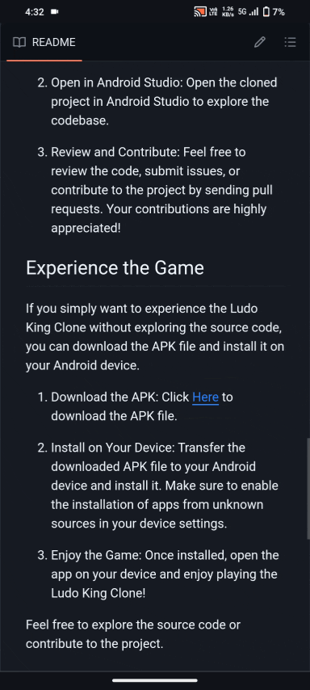

# Ludo King Clone Project

## Overview

Welcome to the repository for my Ludo King Clone project! This project was developed as a demonstration of my Android app development skills using Android Studio. Inspired by the popular Ludo King game, I aimed to recreate the classic board game experience for mobile devices.

## Game Preview


Watch a quick preview of the Ludo King Clone to see the gameplay in action!

## Controlling game with remote preview


We can control this game remotely so that one could always win 😜 you can watch the full video here in my youtube channel:
https://youtu.be/LZA4MgA7pQo?feature=shared


## Features

- **Gameplay Replication:** The project faithfully reproduces the gameplay mechanics of the classic Ludo King, allowing users to experience the thrill of the game on their Android devices.

- **Multiplayer Support:** I have implemented a multiplayer functionality that enables users to play against their friends in real-time, just like the original game.

- **Customization Options:** Users can customize their gaming experience by choosing from different player tokens, board designs, and avatars.

- **Responsive UI:** The user interface is designed to be intuitive and responsive, providing a seamless gaming experience across various screen sizes.

## Technologies Used

- **Android Studio:** The project is developed using Android Studio, making use of its powerful tools and features for Android app development.

- **Java Programming Language:** I utilized Java to write the backend logic of the game, ensuring efficient and reliable performance.

## How to Use

If you're interested in exploring the source code or contributing to the development of my Ludo King Clone Project, follow these steps:

1. **Clone the Repository:**
   ```bash
   git clone https://github.com/Vinaykpro/Ludo_King_Clone.git

‎ ‎ ‎ This command retrieves the source code of the game to your local machine.

2. **Open in Android Studio:**
Open the cloned project in Android Studio to explore the codebase.

3. **Review and Contribute:**
Feel free to review the code, submit issues, or contribute to the project by sending pull requests. Your contributions are highly appreciated!

## Experience the Game (Download Release APK)

Download and install the pre-compiled Android release APK directly from this repository:

- 📦 **Direct APK Download**: [release/LudoKing-Release-v1.0.0.apk](release/LudoKing-Release-v1.0.0.apk)
- 🚀 **GitHub Releases**: [Latest Release v1.0.0](https://github.com/rjraj111/Lodu-King-Dummy/releases)



1. **Install on Your Device:**
   Transfer `LudoKing-Release-v1.0.0.apk` to your Android device and install it (enable "Install unknown apps" if prompted).

2. **Enjoy the Game:**
   Launch the app on your mobile device to play the pixel-perfect Ludo King game!

Feel free to explore the source code or contribute to the project.
